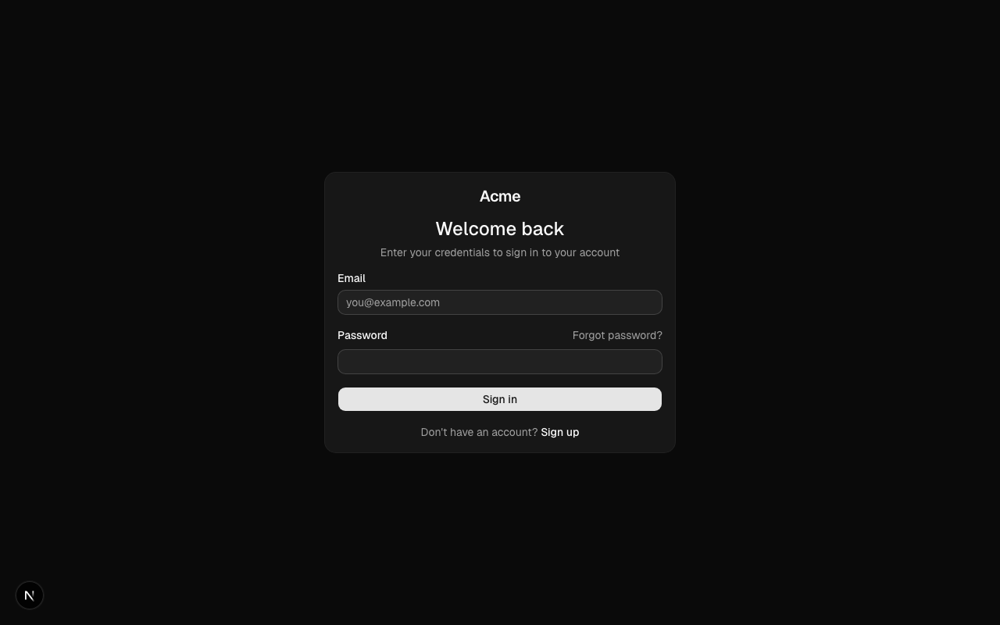
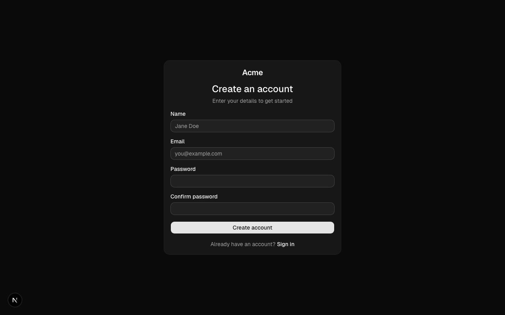
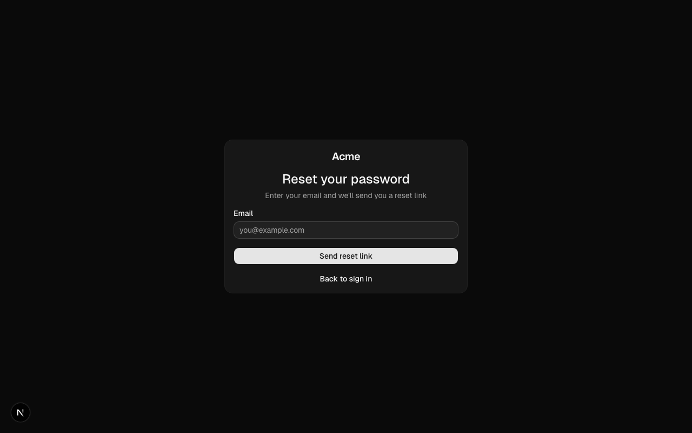
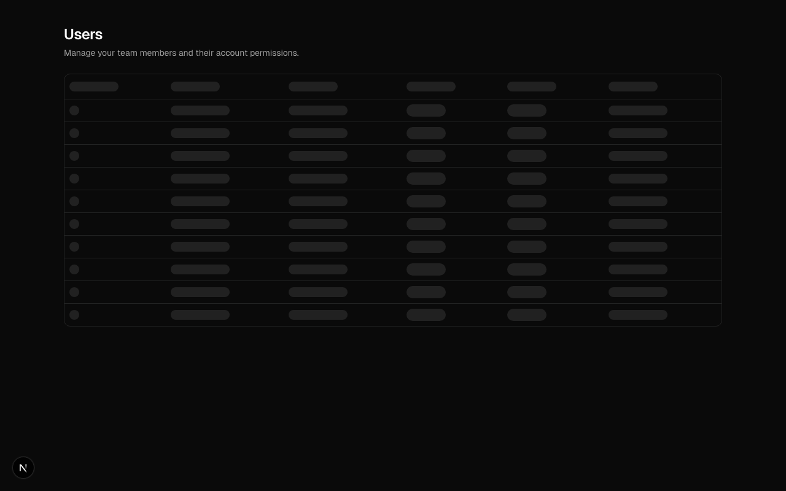
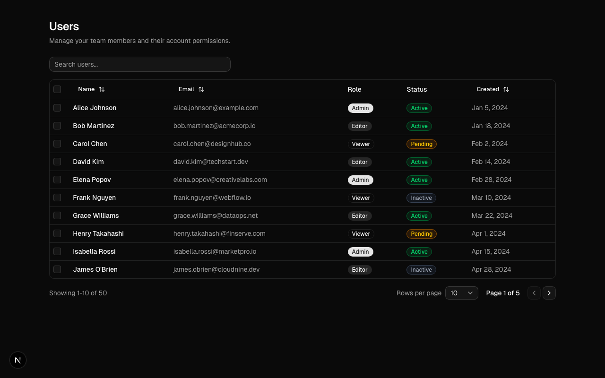
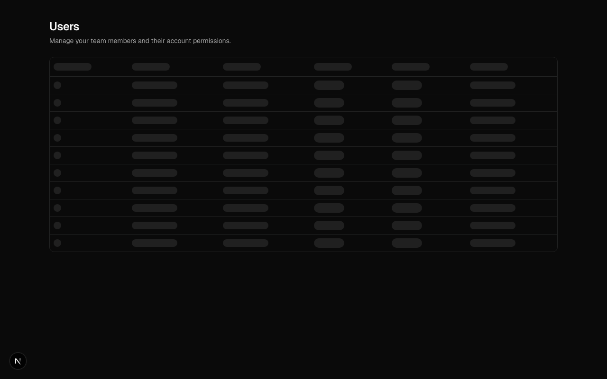

# agent-ready-shadcn-starter

> Ship AI-generated UI without shipping AI-generated mistakes.

[](LICENSE)
[](CONTRIBUTING.md)

**[Live Demo](https://agent-ready-shadcn-starter.vercel.app)**

[](https://vercel.com/new/clone?repository-url=https%3A%2F%2Fgithub.com%2Freckziegelwilliam%2Fagent-ready-shadcn-starter&project-name=agent-ready-shadcn-starter&repository-name=agent-ready-shadcn-starter)

---

## New to vibe coding? Your first 10 minutes

You need [Node.js 20+](https://nodejs.org/), [pnpm 9](https://pnpm.io/installation) and an AI coding tool (Cursor, Claude Code, or Codex).

**1. Clone and run it (about 3 minutes)**

```bash
git clone https://github.com/reckziegelwilliam/agent-ready-shadcn-starter.git
cd agent-ready-shadcn-starter
pnpm install
pnpm dev
```

Open http://localhost:3000. Click through the six examples, then look at [`/compare`](http://localhost:3000/compare) (what the AI got wrong, side by side with the fix) and [`/quality`](http://localhost:3000/quality) (scores per example).

**2. Open it in your agent and say what you want (about 5 minutes)**

Open the folder in Cursor, run `claude` or `codex` in it, and describe the feature in plain words, for example:

> add a billing page where users can see their plan, change it, and see past invoices

You don't need to copy prompts around. The repo ships an [`AGENTS.md`](AGENTS.md) (and a `CLAUDE.md` that imports it) that tells the agent to:

1. pick the closest of the six examples,
2. write a spec and state matrix for your feature in `packages/specs/`,
3. follow the matching prompt pack in `packages/prompts/`,
4. check the result against the review checklists in `packages/review-checklists/`,
5. run lint, typecheck, tests and build.

`.mcp.json` and `.cursor/mcp.json` also register the [shadcn MCP server](https://ui.shadcn.com/docs/mcp), so the agent can look up real shadcn components instead of guessing.

**3. Check the work (about 2 minutes)**

```bash
pnpm lint && pnpm typecheck && pnpm test && pnpm build
```

Then open the new page and try the unhappy paths: empty data, a slow network, bad input.

### About the deploy button

The button deploys the Next.js web app, same as the live demo. The landing page, `/dashboard`, `/compare` and `/quality` work on their own. Login/signup, `/settings`, `/wizard` (submit), `/items` and `/upload` call the NestJS API in `apps/api`, which the button does not deploy, so on a fresh deploy those pages show an error state. To make them work, host the API somewhere and set `NEXT_PUBLIC_API_URL` on the Vercel project (and add your web URL to the CORS list in `apps/api/src/main.ts`). Locally, `pnpm dev` runs both.

## Why this exists

AI can generate UI fast, but generated projects often don't run cleanly out of the box. Models are better at generation than verification. Consistency drifts across multi-file changes. Accessibility, error states, and edge cases are afterthoughts.

This is not a starter kit. It is a **hardening framework** — a system for turning AI-generated code into production-safe features.

## The five pillars

1. **Scaffold** — Generate feature structure with specs, state matrices, and prompt templates (`pnpm turbo gen feature`)
2. **Spec** — Define every state, validation rule, and acceptance criterion before generating code
3. **Instruct** — Give agents structured prompts with project context, not vague one-shot requests
4. **Evaluate** — Score output on accessibility, type safety, state coverage, and consistency ([`/quality`](https://agent-ready-shadcn-starter.vercel.app/quality))
5. **Repair** — Compare AI output against production code, document every fix ([`/compare`](https://agent-ready-shadcn-starter.vercel.app/compare))

## What's inside

- **Before/after repair viewer** — Side-by-side diffs showing what AI got wrong and how it was fixed
- **Quality dashboard** — Real scores per example: accessibility, types, state coverage, tests
- **State matrices** — Every feature specifies all 10 states (loading, empty, error, offline, etc.)
- **Feature scaffold CLI** — `pnpm turbo gen feature` creates spec, state matrix, prompt, and review template
- **Reproducibility CI** — Every push verifies fresh install, build, tests, and route rendering
- **Production review checklists** — Checklist-driven review for accessibility, types, states, and consistency
- **Reusable prompt packs** — Structured agent instructions, not just "generate a login form"
- **Six golden examples** — Auth flow, dashboard table, settings page, multi-step wizard, optimistic CRUD and file upload, each with spec → prompt → implementation → review notes
- **Agent instructions** — [`AGENTS.md`](AGENTS.md) / `CLAUDE.md` so Cursor, Claude Code and Codex follow the workflow automatically, plus shadcn MCP config

## Commands

| Command | What it does |
|---------|--------------|
| `pnpm dev` | Web on http://localhost:3000, API on http://localhost:4000 |
| `pnpm build` | Build everything |
| `pnpm lint` | ESLint |
| `pnpm typecheck` | TypeScript |
| `pnpm test` | Vitest (web + API) |
| `pnpm turbo gen feature` | Scaffold spec, state matrix, prompt pack, example docs and page for a new feature |

## Feature examples

| Example | Route | Status | Description |
|---------|-------|--------|-------------|
| [Auth Flow](examples/auth-flow/) | `/login` | Done | Login, signup, forgot password with validation |
| [Dashboard Table](examples/dashboard-table/) | `/dashboard` | Done | Sortable, filterable, paginated data table (mock data) |
| [Settings Page](examples/settings-page/) | `/settings` | Done | Tabs, toggles, form save state |
| [Multi-step Wizard](examples/multi-step-wizard/) | `/wizard` | Done | Step validation, progress indicator, review step |
| [Optimistic CRUD](examples/optimistic-crud/) | `/items` | Done | Create/edit/delete with optimistic updates and rollback |
| [File Upload](examples/file-upload/) | `/upload` | Done | Drag and drop, preview, progress tracking |

Each example includes a **spec** and **state matrix** (`packages/specs/`), a **prompt pack** (`packages/prompts/build-*.md`), the **final implementation** (`apps/`), and **review notes** (`examples/*/review.md`) showing what the AI got wrong and how it was corrected.

## Screenshots

### Auth Flow

| Login | Signup | Forgot Password |
|-------|--------|-----------------|
|  |  |  |

### Dashboard Table

| Loading State | Loaded |
|---------------|--------|
|  |  |

### Feature Demos




## Repo structure

```
agent-ready-shadcn-starter/
├── AGENTS.md                       # Instructions for AI coding agents (CLAUDE.md imports it)
├── .mcp.json, .cursor/mcp.json     # shadcn MCP server for Claude Code and Cursor
├── apps/
│   ├── web/                        # Next.js 16 frontend
│   │   ├── app/                    # App router pages
│   │   │   ├── (auth)/             # Login, signup, forgot-password
│   │   │   ├── dashboard/          # Data table
│   │   │   ├── settings/           # Settings tabs
│   │   │   ├── wizard/             # Multi-step wizard
│   │   │   ├── items/              # Optimistic CRUD
│   │   │   ├── upload/             # File upload
│   │   │   ├── compare/            # Before/after repair viewer
│   │   │   └── quality/            # Quality dashboard
│   │   ├── components/             # Feature components, one folder per feature
│   │   ├── features/               # Redux slices + tests, one folder per feature
│   │   ├── hooks/                  # Custom React hooks
│   │   └── lib/                    # Store, mock data, compare/quality data
│   └── api/                        # NestJS 11 backend
│       └── src/                    # auth, tasks, settings, onboarding, uploads, health
├── packages/
│   ├── ui/                         # Shared shadcn/ui components (Base UI, base-nova)
│   │   ├── src/                    # components, hooks, lib (cn), styles (Tailwind v4)
│   │   └── turbo/generators/       # `pnpm turbo gen feature` templates
│   ├── specs/                      # Feature specs + state matrices
│   ├── prompts/                    # Prompt packs (build-*.md) + general/ passes
│   ├── review-checklists/          # Production review checklists
│   ├── eslint-config/              # Shared ESLint configuration
│   └── typescript-config/          # Shared TypeScript configs
├── examples/                       # One folder per example: README.md + review.md
│   ├── auth-flow/
│   ├── dashboard-table/
│   ├── settings-page/
│   ├── multi-step-wizard/
│   ├── optimistic-crud/
│   └── file-upload/
├── docs/                           # Getting started, architecture, Claude/Codex guides, rubric
├── public/                         # Screenshots and demo GIFs
├── turbo.json                      # Turborepo pipeline config
├── pnpm-workspace.yaml             # pnpm workspace definition
└── package.json                    # Root package with turbo scripts
```

## Prompt packs

Reusable prompts for AI coding agents. These are not just "generate a login form" -- they provide structured context, step-by-step implementation instructions, and verification criteria. If you use an agent that reads `AGENTS.md`, it will find and follow these on its own.

| Pack | Purpose |
|------|---------|
| `packages/prompts/build-*.md` | One prompt per example: auth flow, dashboard table, settings page, multi-step wizard, optimistic CRUD, file upload |
| `packages/prompts/general/` | Reusable passes: new feature from spec, spec to page, spec to API, Redux slice, shadcn component, add states, accessibility, testing, refactor to production, review |

See [`packages/prompts/README.md`](packages/prompts/README.md) for the full list.

Each prompt pack includes:

1. **Context** -- tech stack, conventions, file locations
2. **Input** -- the spec and existing code to read first
3. **Instructions** -- ordered steps
4. **Output** -- the files to produce
5. **Verification** -- what to check before considering it done

## Production review rubric

After AI generates code, run it through these checklists:

- **Accessibility** -- ARIA labels, keyboard navigation, focus management, screen reader support
- **States** -- Loading, empty, error, success, partial data, offline
- **Types** -- Strict TypeScript, no `any`, discriminated unions for state
- **Responsive** -- Mobile-first, breakpoint testing, touch targets
- **Performance** -- Bundle size, re-renders, memoization, lazy loading
- **Security** -- Input sanitization, CSRF, auth checks, rate limiting

See [`docs/production-review-rubric.md`](docs/production-review-rubric.md) for the full rubric.

## Tech stack

| Technology | Version | Purpose |
|------------|---------|---------|
| Next.js | 16.4 | React framework with App Router |
| React | 19.3 | UI library |
| shadcn/ui | CLI 4.23, Base UI, `base-nova` style | Component primitives |
| Tailwind CSS | 4.3 | Utility-first styling |
| Redux Toolkit | 2.x | State management |
| React Hook Form | 7.x | Form handling |
| Zod | 3.x | Schema validation |
| NestJS | 11 | Backend API framework |
| Turborepo | 2.x | Monorepo build system |
| pnpm | 9.x | Package manager |
| TypeScript | 5.9 | Type safety |

## Philosophy

AI-assisted development works best when you:

1. **Start with a clear spec.** Define what you are building before asking the agent to build it.
2. **Give the agent structured context.** File paths, conventions, existing patterns, and constraints.
3. **Review output against a checklist.** Not vibes -- a concrete list of production requirements.
4. **Fix patterns, not just symptoms.** When AI gets something wrong, update the prompt so it gets it right next time.

This repo codifies that workflow into something you can clone, use, and extend.

## Contributing

PRs welcome. See [CONTRIBUTING.md](CONTRIBUTING.md) for guidelines on adding feature examples, writing specs, creating prompt packs, and the PR process.

## License

[MIT](LICENSE)
